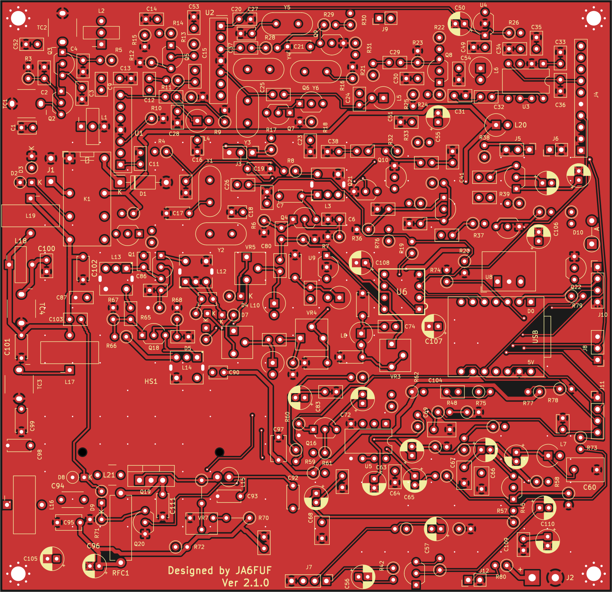
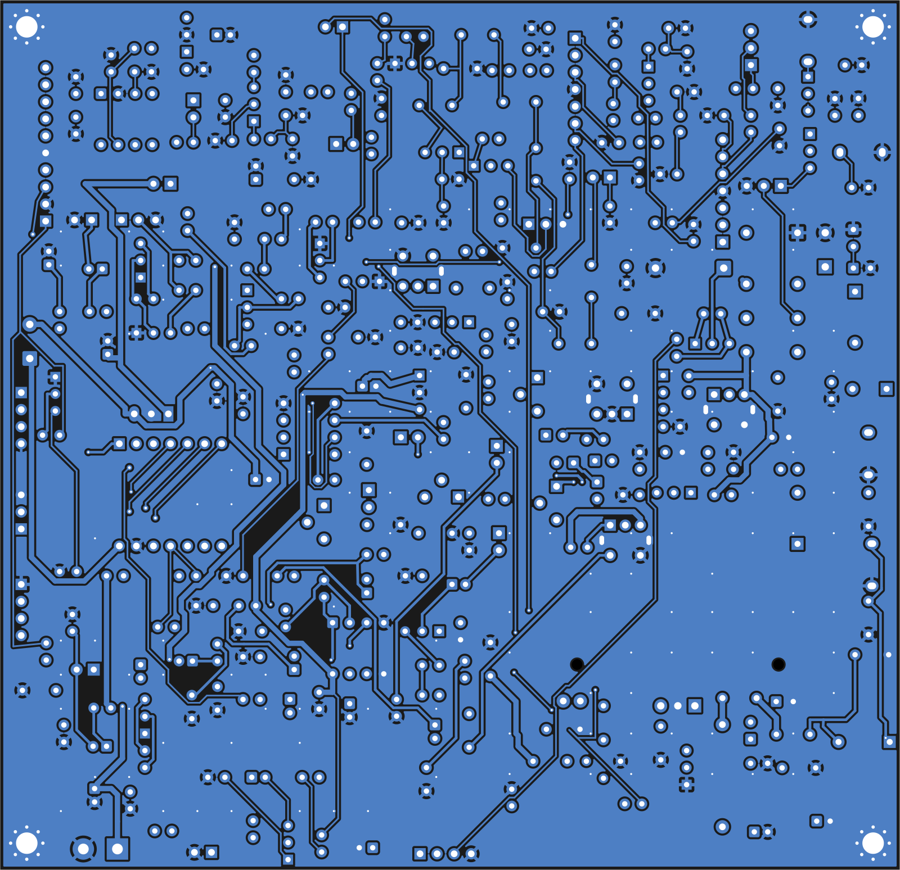
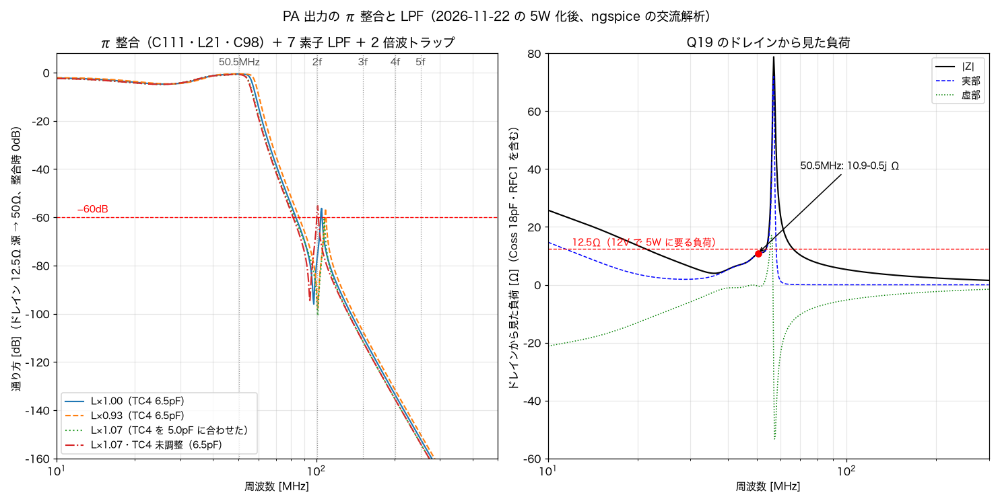
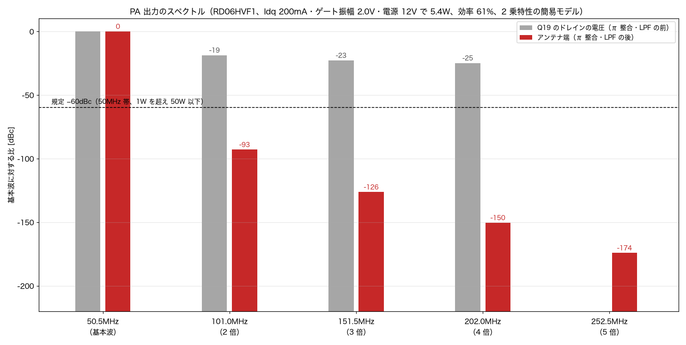
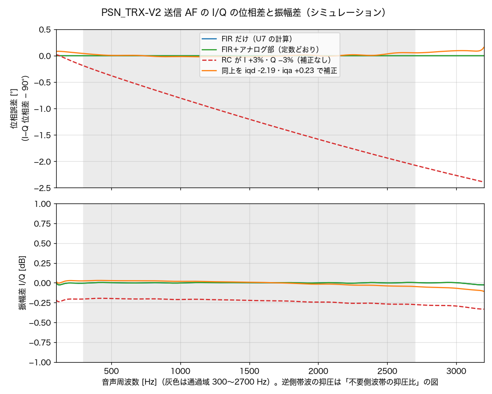
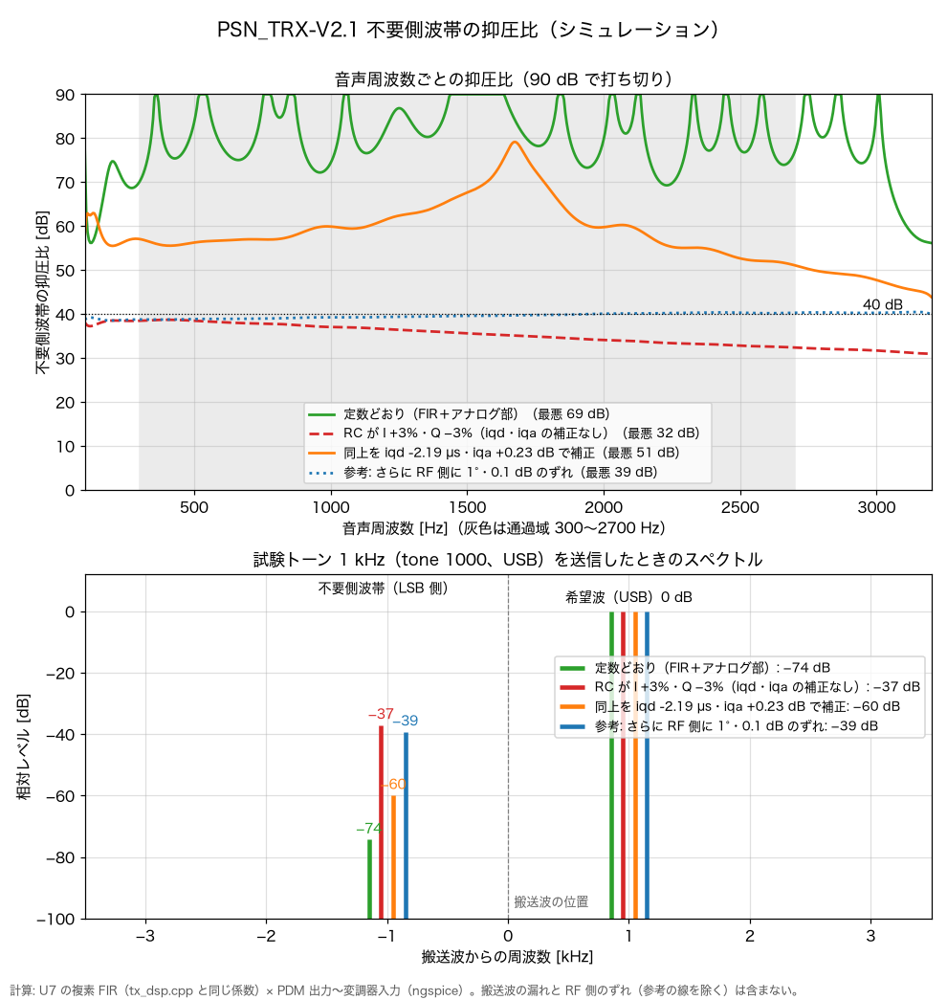

# PSN_TRX_XIAO_ESP32C3-V2.1

Seeed Studio XIAO ESP32C3 + Si5351 を使用した PSN 方式 SSB トランシーバー（KiCad 10.0）。

## 基板 V2 Ver 1.4 → Ver 2.1.0 の変更点

[V2](https://github.com/kazushinjo/PSN_TRX_XIAO_ESP32C3-V2)（基板 V2 Ver 1.4、2026-11-11）からの変更です（2026-11-19〜22）。どれも計算・基板データ上の確認で、**実機は未確認**です。日ごとの詳細は下の「変更履歴」。

### 部品・回路

| 項目 | V2 Ver 1.4 | Ver 2.1.0 |
|---|---|---|
| U1・U2（NJM2594V） | 表面実装（SSOP8） | **秋月の SIP 化基板**（113476、NJM2594V 実装済み、7 ピン 2.54mm）。**表面実装部品がなくなった** |
| 送信出力 | 約 1W（計算で最大 約 1.7W） | **尖頭 5W**（電源 12V、計算） |
| Q18（励振） | 2SC1815（fT 80MHz） | **KSP10**（onsemi、fT 650MHz、ピン B-E-C） |
| Q19 の出力 | ドレインに 50Ω の LPF をそのまま | **π 整合**を追加: C111 330p（新）・L21 62nH 自作空芯コイル（新）・C98 39p → **270p**。ドレインに約 11Ω を見せる |
| C94（出力の直流カット） | 0.001µF | **0.01µF C0G**（L21 と C98 の間へ移設） |
| L15（PA 入力整合） | 270nH | **330nH** |
| C110（J2 の横） | 0.01µF セラミック | **100µF 電解** |
| ヒューズ | 1A | **2A**（5W 送信で全体 約 1A） |
| 部品点数（基板実装） | 280 点 | **282 点** |
| ファームウェアの `out` 初期値 | 10% | **5%**（下限 1%）。尖頭 5W で止めて使う |

### 部品形（足の間隔・外形を、秋月の商品ページの実物に合わせた）

| 部品 | V2 Ver 1.4 | Ver 2.1.0 |
|---|---|---|
| TO-92 の 23 個（Q1〜Q18・Q20〜Q22・U4・U9） | 足の間隔 1.27mm | **2.54mm**（`TO-92_Inline_Wide`） |
| C66〜C69（3300pF フィルム） | 2.5mm（セラミック用） | **3.5mm**（ルビコン F2D、秋月 110334） |
| C60（0.068µF フィルム） | 2.0mm | **5.0mm**、外形 8.0 × 5.0mm（ルビコン F2D） |
| C47・C48・C96・C110（100µF 電解） | φ6.3・2.5mm | **φ5・2.0mm** |
| C8・C17・C19・C21・C76〜C79（5mm 品） | 2.5mm の穴に足を寄せる | **5mm** の穴 |
| C59（0.01µF） | 2.0mm | **2.5mm** |
| 小さいセラミック（C1・C4・C16・C18・C20・C24・C31・C84・C86・C90・C95・C97・C100・C103） | 外形が実物より小さい | 実物の大きさ |
| J2（電源入力） | 穴 φ1.1mm | **φ1.6mm**（AWG18〜16） |
| J1（アンテナ、同軸のじか付け） | 穴 φ1.1mm・間隔 2.54mm | 穴 φ1.1mm・間隔 **5.08mm** |

### 基板

- 上の変更に合わせて部品を動かし、配線を引き直した。マイク入力の 7 点・J7・J8・J11・R73・J12 も移動した。
- いらない配線とビアを、合わせて 60 個消した: 長さ 0 の線、重なった線、0.1mm 未満の段差、どこにもつながらないビア（11/20 に 15 個、11/22 に 45 個）。
- シルクの版数を「V2 Ver 1.4」→「**Ver 2.1.0**」にした。
- DRC 0（警告も 0）・未配線 0・回路図との不一致 0、ERC 0。

### 資料

- **追加**
  - 部品実装図（段階組立）: 電源を入れて確かめながら組み立てる手順。
  - シミュレーション報告書の 8 章「スプリアスと相互変調」。
  - PA の図 2 枚（`kicad/sim/pa_plots.py`）。
- **作り直し**
  - 製造データ（ガーバー・CPL・BOM）、部品表（秋月版・サトー版）
  - 間違いやすい部品形、原寸確認図、Word 4 本
  - 調整手順（L21 の合わせ方、出力を尖頭 5W で止める）、操作説明書
  - README の基板の図
- **シミュレーション**（`kicad/sim`）: π 整合と KSP10 に合わせ、高調波と 2 トーンの相互変調を計算するようにした。
  - 高調波は最大 −91dBc（規定 −60dBc）。
  - 2 トーンの IM3 は尖頭 4.5W で −37dB。
- **古い版として残しているもの**: 部品実装図（ブロック別）は V2 Ver 1.4 のまま。旧基板の段階組立も残している。

> **基板 Ver 2.1.0（作業中）**: [PSN_TRX_XIAO_ESP32C3](https://github.com/kazushinjo/PSN_TRX_XIAO_ESP32C3) を元に、受信部をダイレクトコンバージョンから SSB のシングルスーパー（IF 12MHz・ラダーフィルタ・積検波）に変更した V2 の改良版（V2.1）。V2 Ver 1.4 から、U1・U2 を秋月の NJM2594V SIP 化基板にして表面実装部品をなくし、TO-92 の足の間隔を 2.54mm に、コンデンサの部品形を秋月の品に合わせ、送信を尖頭 5W にした（Q18 KSP10・π 整合）。回路図・基板（134.1 × 129.7mm、配線済み・DRC エラー 0）・ファームウェア（ビルドのみ）・部品表・シミュレーションは更新済み。**実機は未確認**。製造データ（ガーバー・JLCPCB 用ファイル、`kicad/production/`）は 2026-11-22 に今の基板から `kicad/make_production.py` で出力済み（基板シルク「Ver 2.1.0」）。部品実装図（`docs/PSN_TRX_部品実装図_段階組立.pdf`、ブロック別は V2 Ver 1.4 の古い版のまま）・部品配置図（`kicad/PSN_TRX_部品配置図.pdf`）・調整手順（[`manual/調整手順.md`](manual/調整手順.md)）・操作説明書（[`manual/README.md`](manual/README.md)）・送信 I/Q の調整手順、組み立て説明書・評価試験報告書・回路図論理検証レポート・VFO 改造仕様書（docx）は Ver 2.1.0 に更新済み。

## 概要

50MHz 帯 PSN（位相シフト網）方式 SSB トランシーバー。VXO（水晶発振器）を
Si5351A クロックジェネレーターによる VFO に置き換え、Seeed Studio XIAO ESP32C3 でデジタル制御する。

Si5351 の CLK0（0°）/ CLK1（90°）二相出力を直接バランスドモジュレーターへ供給することで、
従来の RF PSN（RC 位相シフト回路）も不要となる。

## 主な仕様

| 項目 | 内容 |
|---|---|
| クロックジェネレーター | Si5351A（AE-Si5351A モジュール、I2C 制御） |
| 周波数範囲 | 50.000 〜 51.000 MHz（6m バンド） |
| 受信方式（V2） | SSB シングルスーパー: 入力同調 L1 → RF 増幅 Q2・Q3（2SK192A-BL カスコード、AGC 付き）→ 出力同調 L2 → 第 1 混合 U1（NJM2594V）→ 混合後増幅 Q5・L 整合 → 12MHz ラダーフィルタ（水晶 6 個）→ IF 増幅 Q6・Q7（2SK192A-BL カスコード、AGC）→ 積検波 U2（NJM2594V）→ AF 前置増幅 Q9 → AF 段 |
| CLK0 出力 | 送信中: 0° → C74・LPF（L8）・VR3 → バランスドモジュレーター 1（D4/D5）。受信中: 第 1 局発（表示周波数 − BFO、38〜39MHz）→ Q4 → L3 → U1 |
| CLK1 出力 | 送信中だけ 90° → C75・LPF（L9）・VR4 → バランスドモジュレーター 2（D6/D7） |
| CLK2 出力（V2） | 受信中だけ BFO（約 12MHz、PLLB）→ R19・R20 → U2。USB はフィルタの通過域の下端の外、LSB は上端の外（シリアルの `bfo usb <Hz>` / `bfo lsb <Hz>` で合わせて保存） |
| チューニングステップ | 10Hz / 100Hz / 1kHz / 10kHz / 100kHz |
| 表示 | Nextion NX4832T035（3.5 インチ シリアル LCD、標準）または OLED SSD1306 128×64（コンパイル時に選択） |
| 周波数記憶 | NVS（電源 OFF 後も保持） |
| S メーター・AGC | V2: IF 増幅（Q6・Q7）の出力を Q8 で増幅して AD8307（対数検波、25mV/dB）で測り、ADS1015（秋月 AE-ADS1015、I2C 0x48）で XIAO が読む。AGC は Q21 で RF 増幅 Q3・IF 増幅 Q7 のゲートを下げる（FAST / SLOW / OFF）。調整値はスケッチの RSSI_S9_MV・AGC_TARGET_MV |
| RIT | ±9.99 kHz・10 Hz 刻み、送信中は自動で外す（送信検出を使うため基板 Ver 1.3 から。Ver 2.0 から送信検出は D0） |
| 送信 I/Q 生成 | マイク → U5A（約 21 倍）→ A2 の ADC（32kHz）→ 複素 FIR（16kHz、127 タップ、300〜2700Hz）→ I2S の PDM で D10（I）・D8（Q）→ 2 段 RC → 変調器（基板 Ver 2.0 から）。調整はシリアルのコマンド（mic・out・iqd・iqa・sb・tone・alc）。デジタル ALC（FIR の前、効き始め -20 dBFS）で過変調と変調器ドライブ（Q15・Q16）のひずみを防ぎ、送信中はメーターを ALC メーターに |
| 操作 | エンコーダを押すと設定モード（ダイヤルで RIT / STEP / AGC を選び、押して値の変更、もう一度押して確定） |

## ハードウェア構成

```
Seeed Studio XIAO ESP32C3 ─ メインコントローラ
├── Si5351A モジュール (AE-Si5351A) ─ I2C クロックジェネレーター
│   ├── CLK0  送信中 0° → バランスドモジュレーター 1（D4/D5）／受信中 第 1 局発 → Q4 → L3 → U1
│   ├── CLK1  送信中だけ 90° → バランスドモジュレーター 2（D6/D7）
│   └── CLK2  受信中だけ BFO → R19・R20 → U2（積検波）
├── ADS1015 モジュール（I2C 0x48）─ A0 = AD8307 の出力（S メーター・AGC）
├── Nextion NX4832T035 LCD（D6/D7 UART）または OLED（D4/D5 I2C）
├── ロータリーエンコーダ（A=D3, B=D1, SW=D9）
├── A2: 送信中のマイク音声（U5A → C65・R52、R73/R74 で 1.65V バイアス）→ 複素 FIR で I/Q を作る
│        （V2 では受信音は来ない）
├── D10: 受信中は AGC の PWM（→ R75・C104 → R76 → Q21 で Q3・Q7 のゲートを下げる）
│        送信中は PDM の I（→ R53・C66・R54・C67 → C70 → Q15）
├── D8: PDM の Q（→ R55・C68・R56・C69 → C72 → Q16、送信中だけ出力）
└── 送信検出 D0（TX12V → R77/R78 → Q22、送信中 LOW）

  受信と送信はリレー K1 で電源（RX12V／TX12V）が切り替わるので、A2・D10 を送受で使い分けられる。
  D0（GPIO2、送信検出）と D9（GPIO9、エンコーダの SW）は起動設定ピンなので、PTT やつまみを押したまま電源を入れない

5W PA: RD06HVF1 (N-ch RF MOSFET) @ 12V, Class AB（2026-11-22 から。π 整合 C111・L21・C98、励振 Q18 KSP10）
```

## 基板パターン

基板は 134.0 × 129.6mm の 4 層（内層 1 = GND ベタ、内層 2 = 電源ベタ）。下の図は今の基板（`kicad/PSN_TRX.kicad_pcb`、2026-11-22 の送信 5W 化の後）から KiCad 10 の `kicad-cli pcb export svg` で出力した（`rsvg-convert -b '#1a1a1a' -w 1600` で PNG に）。

### 表面（部品面、F.Cu とシルク）



### 裏面（はんだ面、B.Cu とシルク、裏から見た向き）



## 5W パワーアンプ（Q19）

励振段（Q17 2SK439 → Q18 KSP10）の出力を増幅する終段アンプ。2026-11-22 に 1W から尖頭 5W に変更した（Q18 を 2SC1815 → KSP10、ドレインに π 整合を追加）。

| 項目 | 内容 |
|---|---|
| トランジスタ | **RD06HVF1**（三菱電機 N-ch RF MOSFET, 175MHz, 6W, TO-220F） |
| 電源電圧 | 12V |
| 動作クラス | Class AB |
| 静止電流 Idq | 200〜400mA（VR7 で調整） |
| 出力 | 尖頭 5W @50MHz（電源 12V、計算）。`out` で 5W に合わせて使う（調整手順の手順 13） |
| 出力整合 | π 整合: ドレイン → C111 330p（GND へ）→ L21 62nH（自作の空芯コイル、内径 φ3mm・0.6mm 線 5 回）→ C94 0.01µF（直流カット、C0G）→ C98 270p（GND へ、LPF の入力側シャントを兼ねる）。ドレインに約 11Ω を見せる（12V で 5W 出すには約 12Ω が要る。50Ω のままでは約 2W で頭打ち） |
| 出力 LPF | 7 素子チェビシェフ＋2 倍波トラップ: C98 270pF（π 整合と兼用）→ L16（T-50-10 9T）→ C99 82pF＋TC3 30p → L17（10T）→ C101 100pF ∥ トラップ（L18 T-30-6 8T ＋ C100 5pF ∥ TC4 10p、101MHz）→ L19（8T）→ C102 68pF → K1。π 整合と合わせ、TC4 を合わせると 2 倍波 −94〜−98dB、3 倍波 −107〜−110dB、挿入損失 0.53〜0.64dB（計算値、ドレイン側 12.5Ω 源） |
| 電源 | 送信 12V（リレー K1 の NO 側）、RFC1 10µH 経由。バルク C96 100µF。5W 送信で電源電流 約 0.8A（全体 約 1A、ヒューズ 2A） |

### バイアス回路

```
送信12V → R70(330Ω) → VR7(500Ω) の 1 番 ─ VR7 の 3 番 → GND
                         VR7 ワイパー(2 番) → R69(10Ω) → Q19 ゲート
```

- ゲート電圧の可変範囲は 0〜約 7.2V（13.8V 電源では約 8.3V）。**最初の送信前に VR7 を GND 側（ゲート 0V）いっぱいに回しておく**（上側いっぱいだと電流が流れすぎて Q19 を壊すおそれがある）
- 無変調で送信し、VR7 を少しずつ回してドレイン電流 (Idq) を 200〜400mA に合わせる。RD06HVF1 のしきい値電圧 Vth は 1.9〜4.9V（データシート）で、データシートの代表特性では Vgs 約 4V から電流が流れ始め、約 5V で 0.3A。合わせたときのゲート電圧は個体によって 4〜6V 程度になる。電流は Vgs に対して急に増えるので、5V を超えたらゆっくり回す
- Q19 のソースは GND 直結

詳細は `docs/PSN_TRX_VFO改造仕様書.docx` を参照。

### ヒートシンク

RD06HVF1（Q19）には秋月電子 **17PB046**（GEC ヒートシンク、46.2×17×25mm、黒アルマイト、熱抵抗 11.9℃/W）を使用（基板 Ver 1.5 から。それまでは 20PB020、15.8℃/W）。
Q19 のタブを基板図の上側（HS1 側）に向け、タブの M3 穴でヒートシンクの取付面にネジ止めする。17PB046 は断面 46.2 × 17mm のうち、取付面からフィン側が 10mm、反対の Q19 側に両端のつば（厚さ約 1.3mm、長さ 7mm）が出ている。Q19 はつばの間に入る（V2 Ver 1.3 で部品形の外形をつば付きの実物どおりに直し、つばに当たっていた L15・L16 を移した）。ヒートシンクの脚ピン（φ1.4、ピッチ 30mm、取付面から 3mm）用に、基板へ φ1.6 の穴（NPTH）を 2 個設けている（HS1）。M3 ねじ穴は基板面から 19mm の高さ。
高さは 20PB020 と同じ 25mm なのでケースはそのまま使える。ヒートシンクの右端がふた上の LCD 基板の下に入らないよう、Q19 とヒートシンクは Ver 1.4 より 2.5mm 左にある（LCD 基板の端から約 1.5mm 離れる）。

## シミュレーション結果（ngspice）

回路図のネットリストから定数を直接読み込み、KiCad 同梱の ngspice（libngspice）で計算した結果です（2026-11-22、送信 5W 化の回路で再計算）。項目ごとの説明と実機で確かめる点をまとめた報告書は [`docs/PSN_TRX_シミュレーション結果.md`](docs/PSN_TRX_シミュレーション結果.md)（PDF 版 `docs/PSN_TRX_シミュレーション結果.pdf`）。スクリプトと全結果は [`kicad/sim/`](kicad/sim/) にあり、`./run.sh` で再計算できます（結果は `kicad/sim/results.txt`。図は numpy・matplotlib の入った Python で `iq_scan.py`・`sideband.py`・`pa_plots.py`）。トランジスタはデータシートの代表値から作った簡易モデルなので、実機では測定で確認してください。

### PA 出力の π 整合と LPF（2026-11-22 の 5W 化後）

Q19 のドレイン →［C111 330p］→ L21 62nH → C94（直流カット）→［C98 270p］→ 7 素子 LPF ＋ 101MHz トラップ → 50Ω。左は、ドレイン側を 12.5Ω 源としたときのアンテナ端までの通り方（10〜500MHz、L のばらつきと TC4 の調整の有無）。右は Q19 のドレインから見た負荷で、50.5MHz で約 11Ω（12V で 5W を出すのに要る約 12Ω）、高調波では低いインピーダンスになる（`kicad/sim/pa_plots.py`）。



PA 出力のスペクトル。RD06HVF1 を 2 乗特性の簡易モデルで近似し、ゲートを 2.0V 振ったとき（5.4W）の、ドレインの電圧（灰）とアンテナ端（赤）の高調波です。破線は 1W を超える場合の許容値 −60dBc。



| | 5 素子 LPF（Ver 1.7 まで） | 7 素子＋トラップ（Ver 1.8〜、1W 版） | π 整合＋7 素子＋トラップ（2026-11-22、5W 版） |
|---|---|---|---|
| 源のインピーダンス（計算の条件） | 50Ω | 50Ω | 12.5Ω（ドレイン） |
| 2 倍波（101MHz）の減衰 | −27〜−31dB | −70〜−76dB | **−94〜−98dB** |
| 3 倍波（151.5MHz）の減衰 | −47〜−51dB | −75〜−80dB | **−107〜−110dB** |
| 挿入損失（50.5MHz） | 約 0.17dB | 0.41〜0.53dB | 0.53〜0.64dB |
| 最適な TC3 | ― | 8〜16pF | 5〜10pF |
| アンテナ端の高調波（送信の全体の計算） | ― | 2 倍波 −67〜−94dBc（最大 約 1.7W） | 2〜5 倍波 最大 **−91dBc**（0.05〜9W） |
| 新スプリアス規定（1W 以下 −43dBc／1W 超 −60dBc） | 1W 超では満たさない | 満たす見込み | 満たす見込み（約 30dB の余裕） |

減衰の範囲は、L19/L16/L17 ±7%・Q19 の出力容量 18〜25pF・トラップのコイル ±7% のすべての組み合わせでの値です。**TC4 を合わせないと 2 倍波の減衰が −53〜−55dB に下がることがある**（π 整合なしでは −30dB 程度）ので、組み立て後に 2 倍波（約 101MHz）が最小になるよう TC4 を調整してください（manual/調整手順.md の手順 9、組み立て説明書 7 章）。高調波は基板の上の結合・寄生発振を含まない計算なので、規定への適合は実測（スペクトラムアナライザ）で確認が必要です。

### 送信の出力と相互変調（2026-11-22 の 5W 化後）

| 電源 | 変調器の音声入力 | 出力（50Ω） | 電源電流 | 2 トーンの IM3（同じ尖頭電力） |
|---:|---:|---:|---:|---:|
| 12V | 100mV | 1.38W | 0.42A | −31dB |
| 12V | 200mV | 4.50W | 0.69A | −37dB |
| 12V | 300mV | 5.70W | 0.80A | −21dB |
| 12V | 800mV | 6.95W | 0.92A | （飽和）|
| 13.8V | 800mV | 9.14W | 1.05A | （飽和）|

尖頭 4.5W までは IM3 −30dB 以下ですが、5.7W を超えると飽和で急に悪くなり、13.8V で上げきると RD06HVF1 の定格（6W）を超えます。**`out` で尖頭 5W に合わせて使います**（manual/調整手順.md の手順 13）。

### 受信の前段の利得

前段の利得は R5（2.2kΩ）と L2 のタップ（RX12V 側から 3 回目）で約 23dB に抑えています（10kΩ なら +28dB・雑音指数 1.0dB だが、混合器に入る信号が 8dB 大きくなる）。その分は Q9 の利得（R29 ÷ R28 ≒ 12）で戻しています。

### そのほかの主な結果

| 項目 | 結果 |
|---|---|
| 直流動作点（電源 11/12/13.8V、hFE 下限〜上限） | 全段とも正常範囲。AF 出力段のアイドル 37〜68mA（R41 最大 0.47W、1W 品）、Q18（KSP10）最大 0.15W |
| 2SK192A-BL カスコード（Q6・Q7、IF 増幅） | R18 100Ω で個体差により 4.6〜10.5mA（標準 7.4mA）。R18 で 5〜8mA に合わせる |
| 2SK192A-BL カスコード（Q2・Q3、RF 増幅、V2） | Id 約 7.4mA（R3 100Ω、個体差で 4.6〜10.5mA）、Q3 の損失 最大 63mW（許容 200mW）、ゲート・ドレイン間 最大 13.8V（耐圧 18V） |
| 送信 AF 系（マイク → A2） | 1kHz 基準で 300Hz 0〜+0.1dB、2700Hz −0.5dB。マイク 1Pa（1kHz）で U5A の出力 約 330mVrms、A2 に約 230mVrms。U5A は 3Pa（103.5dB SPL）付近から頭打ち |
| 送信 AF 系（PDM 出力 → 変調器入力） | 1kHz 基準で 300Hz 0dB、2700Hz −0.4dB。PDM の 78kHz で −30dB 以下 |
| I/Q 位相差 | 90° からのずれ 0°（FIR の計算）→ 逆側帯波の抑圧 約 70dB。RC が I/Q で ±3% ずれると最大 2.1°（約 32dB）、iqd・iqa で補正して約 50dB（下の図） |
| 受信 AF 系（積検波 U2 → Q9 → スピーカー、V2） | 1kHz 基準で 300Hz +0.3dB、2700Hz −2.0dB、利得 41.9dB（音量 0.9）。歪み率 1% 以下は 3.8mW まで、3% 以下は 23mW、10% 以下は 76mW、最大 約 113mW |
| 受信の前段（V2、入力同調 → Q2・Q3 → 出力同調） | 電力利得 +22.6dB、雑音指数 0.88dB（2SK192A-BL・R3 100Ω）。−3dB 帯域 49.2〜51.9MHz。イメージ（26.5MHz）−48dB、半 IF（44.5MHz）−20dB、局発の漏れ −32dB。TC1・TC2 は約 11.0pF・18.5pF。AGC で −15.7dB（Q3 のゲート 1V で −3.9dB、0V で −15.7dB） |
| ラダーフィルタ（V2、水晶の運動定数は仮定） | 損失 6.1dB、−6dB 幅 2.56kHz、−60dB 幅 7.7kHz、リップル 3dB。終端は両側 330Ω（入力は L4・C16 の L 整合） |
| 受信のレベル配分（V2、NJM2594 の変換利得 0dB と仮定） | アンテナ端 → 積検波の入力 +60.1dB。S9 で積検波の出力 約 50mV、スピーカーは出力段の最大（約 113mW）。AD8307 の入力 S1 −52dBm・S9 −4dBm |
| 受信の全体（V2、アンテナ → スピーカーを通した計算、full.py） | アンテナ → スピーカー 約 +101dB（1kHz、音量 0.9。小信号の線形計算なので、S9 のスピーカー出力は線形の値（約 4.3W 相当）ではなく出力段の最大 約 113mW で頭打ち）。音声の −6dB 帯域 300〜2830Hz。逆側帯波 −33dB（1kHz）・−49dB（2kHz）、隣接 +5kHz −69dB・−5kHz −78dB、イメージ −48dB。前段の雑音指数 0.9dB・電力利得 +22.6dB、混合器の雑音指数を 10〜15dB として全体 1.0〜1.4dB、最小検出信号 約 −139dBm（帯域 2.4kHz） |
| 送信の全体（局発・変調器 → Q18 KSP10 → PA → π 整合・LPF → 50Ω の過渡解析、full.py。7T50 の値は仮定、2026-11-22 の 5W 化で再計算） | 電源 12V で変調器の音声入力 100mV で 1.38W、200mV で 4.5W、300mV で 5.7W（電源電流 0.8A）、上げきると 12V で約 7W・13.8V で約 9W（`out` で尖頭 5W に止める）。アンテナ端の 2〜5 倍波は最大 −91dBc（規定 −60dBc に約 30dB の余裕。基板上の結合・発振は含まない）。2 トーンの IM3 は尖頭 4.5W で −37dB、5.7W で −21dB。キャリアの漏れは VR5・VR6 の中点で +10dBm、合わせると −13dBm（5W に対して −50dBc）。I と Q の RF 側の位相差は中点で 93.3°（RF 側だけで抑圧 31dB）→ VR3・VR4 で 90° に合わせ、振幅の差を iqa で補正して 57dB |
| ブロックごとの確認（blocks.py、2026-11-05） | 7T50（FCZ 07S50、0.51〜0.80µH）は L3・L12〜L14 ともコアの範囲内。U1 のキャリア入力 約 350mVrms、U2（BFO）約 100mVrms。IF・S メーターの同調ずれは 12MHz で 0.5dB 以下の差で変更不要。送信表示の LED は約 10mW 以上で点灯。Q1 は十分飽和 |
| PA 入力 | C92 150p → C93 33p（GND へ）→ L15 330nH の L 型整合（V2 Ver 1.4 で 270nH、2026-11-19 に 330nH）。50Ω 源に対し不整合損失 0.1〜1.5dB（励振が弱いとき 0.1〜0.4dB、強いとき 1.4〜1.5dB。2026-11-22 に再計算） |
| PA 出力の π 整合（2026-11-22） | C111 330p・L21 62nH・C98 270p で、ドレインから見た負荷 10.6〜11.0Ω（50〜51MHz）、2 倍波 5.2Ω・3 倍波 3.2Ω。RFC1 にはドレインの直流 約 0.7〜0.8A（AL0510-100K の定格 2.5A） |
| PA 大信号（簡易モデル、ゲート直接駆動、π 整合あり） | Idq 200mA・ゲート振幅 2.0V で 5.4W・効率 61%・電源電流 0.74A、ドレインの最大 23.8V（RD06HVF1 の VDSS 50V）、損失 約 3.5W（放熱器 HS1 で約 +40℃）。整合なし（1W 版）は同じ駆動で 2.2〜2.5W が上限だった |
| DC-DC 入力フィルタ | 共振 16kHz のピーク 1.5〜4.1Ω。R-78E の負性入力抵抗より十分小さく安定 |
| AGC | PWM の平均 0.55〜0.80V でゲートが 4.0V → 0.1〜0.2V。RF 増幅（Q3）−15.7dB ＋ IF 増幅（Q7）−15.5dB で計 約 −31dB |

### 送信 I/Q の位相差と振幅差

AF の周波数を 100〜3200Hz でスキャンし、I と Q の位相差の 90° からのずれ（上）と振幅差（下）を計算したもの（そこから決まる逆側帯波の抑圧は、次の「不要側波帯の抑圧比」の図の上の段）。U7 の FIR はファームウェアと同じ係数（int16 に丸めた後）、その後ろの RC〜変調器入力は ngspice で計算しています（`kicad/sim/iq_scan.py`）。FIR は I 側が左右対称・Q 側が逆対称の係数なので位相差はちょうど 90° になり、抑圧は振幅のわずかなリップルで決まります。RC がずれたときのずれは周波数に比例する（遅延の差になる）ので、`iqd`（遅延差）・`iqa`（利得差）でほぼ打ち消せます。3.3kHz より上は FIR の阻止域（出力がほぼ 0）なので表示していません。



### 不要側波帯の抑圧比

上は音声周波数ごとの抑圧比、下は試験トーン 1kHz（`tone 1000`、USB）を送信したときにスペクトラムアナライザで見える形です（`kicad/sim/sideband.py`）。部品が定数どおりなら約 70dB、RC が I/Q で ±3% ずれても `iqd`・`iqa` の補正で約 50〜60dB。ただし RF 側（Si5351 の 2 出力・変調器）に 1°・0.1dB のずれがあるだけで約 39dB になり、実機の抑圧比はほぼ RF 側で決まります（RF 側は計算に含めていないので、参考の線として重ねています）。



実機での `iqd`・`iqa` の合わせ方（試験トーンと SDR・受信機を使う手順、記録表つき）は [`manual/送信IQ調整手順.md`](manual/送信IQ調整手順.md) にまとめています。

詳しい数値は評価試験報告書 6.5 と JLCPCB 提出資料 4.1・4.2 にまとめています。

## KiCad ライブラリ状態

| ファイル | 状態 |
|---|---|
| `kicad/PSN_TRX.pretty/` | 全12フットプリント KiCad 10 形式 ✅ |
| `kicad/PSN_TRX.kicad_sym` | カスタムシンボル（RD06HVF1 含む）✅ |
| `kicad/fp-lib-table` | PSN_TRX ライブラリ登録済み ✅ |
| DRC ライブラリエラー | **0件** ✅ |

## ファイル構成

```
kicad/
  PSN_TRX.kicad_sch       - 回路図
  PSN_TRX.kicad_pcb       - PCB レイアウト（配線済み、DRC 0）
  PSN_TRX.kicad_sym       - カスタムシンボルライブラリ
  PSN_TRX.pretty/         - カスタムフットプリントライブラリ（12点）
  BOM.md                  - 部品表（Markdown・購入先と購入先の型番付き）
  bom.csv                 - 部品表（kicad-cli で回路図から出力した CSV）
  bom_purchase.csv        - 購入用部品表（購入先・型番・販売コード・入数・価格、UTF-8 CSV）
  make_bom_purchase.py    - bom.csv から bom_purchase.csv を作り BOM.md に購入先を入れるスクリプト
  sim/                    - ngspice によるアナログ部の計算（run.sh → results.txt、iq_scan.py・sideband.py → I/Q 位相差・抑圧比のグラフ）
  production/             - JLCPCB 提出用（ガーバー zip・CPL・BOM・提出資料）
PSN_TRX_XIAO_ESP32C3/
  PSN_TRX_XIAO_ESP32C3.ino - XIAO ESP32C3 のスケッチ（VFO・表示・S メーター・AGC）
  tx_dsp.cpp / tx_dsp.h    - 送信 I/Q の生成（ADC・複素 FIR・PDM）と受信音のサンプリング（Ver 2.0）
docs/
  PSN_TRX_VFO改造仕様書.docx  - VFO 仕様書（Si5351・XIAO の接続、局発・BFO、送信 I/Q、PA）
  PSN_TRX_組み立て説明書.docx  - 組み立て説明書（部品の取り付け・配線・調整の流れ）
  PSN_TRX_評価試験報告書.docx  - 評価試験報告書（ERC・DRC・配線長・計算・シミュレーション）
  PSN_TRX_シミュレーション結果.md / .pdf - アナログ部シミュレーションの報告書（kicad/sim の結果を項目ごとにまとめたもの）
  PSN_TRX_回路図論理検証レポート.docx - 回路図の論理検証（信号の流れ・ファームウェアとの照合・確認事項）
  PSN_TRX_部品実装図_ブロック別.pdf      - 部品実装図（全体図・ブロック別 13 ページ・調整箇所）
  PSN_TRX_部品実装図_段階組立.pdf      - 部品実装図（段階 0〜13 を通電・確認しながら組み立てる、31 ページ）
  PSN_TRX_部品実装図_段階組立_旧基板.pdf - 上と同じ段階組立の図を、11/19 の変更前の基板（V2 リポジトリ da42e3c）で描いたもの
  PSN_TRX_間違いやすい部品形.pdf - 間違いやすい部品の部品形（寸法・ピン名・つながる信号入り、9 ページ。PNG は images/fp_check/）
  tools/                      - 部品実装図（make_parts_layout.py、V2 は make_parts_layout_v2.py＋build_stages_v2.json）・間違いやすい部品形（make_fp_check.py）・docx（make_docx.py）・シミュレーション報告書の PDF（make_sim_report_pdf.py）を作るスクリプト
  images/                     - README の図（PA 出力 LPF の特性・PA 出力のスペクトル・送信 I/Q の位相差）
```

## 変更履歴

| 日付 | 変更内容 |
|---|---|
| 2026-11-22 | **シルク「Designed by JA6FUF」「Ver 2.1.0」を J7 の左横（基板の下の辺沿い）へ**移動し、J7 の番号を J7 の上へ。DRC 0、製造データ・図を出し直し |
| 2026-11-22 | **R73・R80・C109・C110 を移動**: R73（C60 と J11 の間で上下 0.2〜0.3mm しか空いていなかった）を左の空きへ縦向きに、R80（J2 に接していた）を左上へ、C109・C110（J2 から約 1mm）を上へ 2mm（C109 は R57 との間をとるため 1.5mm）。配線を引き直し（C110 の下を通っていた +12V の裏面の線を C110 の左へ）。DRC 0・未配線 0・回路図との不一致 0、製造データ・資料を出し直し |
| 2026-11-22 | **J1（アンテナ）の穴の間隔を 2.54 → 5.08mm に**（穴 φ1.1mm のまま、新しい部品形 `PSN_TRX:SolderWire_1x02_P5.08mm_D1.1mm`。1 番（芯線）の位置はそのまま、2 番（編組、GND）を上へ 2.54mm）。DRC 0・ERC 0、製造データ・資料を出し直し |
| 2026-11-22 | **基板の版数を Ver 2.1.0 に**（シルク「V2 Ver 1.4」→「Ver 2.1.0」、回路図の版数、資料の表題）。製造データ・資料を出し直し |
| 2026-11-22 | **送信を尖頭 5W に**: Q18 を 2SC1815 → **KSP10**（onsemi、fT 650MHz、ピン B-E-C、基板は 180° 回して E・C の線を引き直し）。Q19 のドレインに **π 整合**（**C111 330p** をドレインの真下、**L21 62nH** の自作空芯コイル（内径 φ3mm・0.6mm 線 5 回）、**C94 0.001u → 0.01u C0G** を L21 の後ろへ移設、**C98 39p → 270p**）を入れ、ドレインに約 11Ω を見せる。計算（kicad/sim）で 12V・尖頭 5W、高調波 最大 −91dBc（規定 −60dBc）。ファームウェアの `out` の初期値 10 → 5%（下限 1%）。ヒューズ 1A → 2A。新しい部品形 2 つ（L21・C94）。C95 を下へ、D9 を 0.2mm 下へ、J9-Pin_1 の線を迂回、GND ビア 1 個削除。部品 280 → 282 点。DRC 0（警告も 0）・未配線 0・回路図との不一致 0、ERC 0。シミュレーションのスクリプトを π 整合・KSP10 に合わせ、高調波は C98 の点の電圧×LPF の通り方で出し、2 トーンの相互変調を追加。報告書・部品表・製造データ・調整手順・資料を更新 |
| 2026-11-22 | **アナログ部のシミュレーションを今の回路で計算し直した**（`kicad/sim/results.txt`・`docs/PSN_TRX_シミュレーション結果.md`・`.pdf` を置き換え）。11-11 から変わったのは L15 270nH → 330nH の分だけで、PA 入力の不整合損失 0.1〜1.5dB、送信の最大出力 約 1.5W（同じ変調器入力で 0.6〜2.8dB 低い）、キャリアの漏れ（中点）−4dBm。ほかの結果・I/Q のグラフは同じ |
| 2026-11-22 | **コンデンサの部品形を秋月の品に合わせた**（秋月の商品ページの足の間隔・大きさと照合）。(1) **C47・C48・C96・C110（100µF 電解、25PX100MEFC5X11）**: φ6.3・2.5mm → **φ5・2.0mm**（C47 は縦向きに置き直し）。(2) **足を寄せていた 5mm ピッチ品**（C8 27p・C17・C21 82p・C19 120p・C76〜C79 47p）の穴を **5mm** に、**C59（0.01µF、2.54mm 品）**を 2.0mm → **2.5mm** に。(3) 外形が実物より小さかった C1・C16・C18・C20・C84・C86・C90（3.8 × 2.5mm）・C4・C100・C103（5 × 2.5mm）・C24・C31（4 × 2.5mm）・C95・C97（5.5 × 3.15mm、新しい部品形 `PSN_TRX:C_Disc_W5.5mm_T3.2mm_P5.00mm_Akizuki_RDER72E`）を実物の大きさに。当たる所は C7・C8・C20・C21・C37・C76・C78・C79・R28・R64・L8 を動かし、C20-Pad1・C21-Pad1・C75-Pad1 の線を引き直し、ビア 2 個を削除、部品番号のシルク 12 か所を移動。あわせて長さ 0・重なり・0.1mm 未満の段差の配線 45 本を削除。DRC 0（警告も 0）・未配線 0・回路図との不一致 0、ERC 0。部品表・製造データ・資料を更新 |
| 2026-11-21 | **C66〜C69（3300pF フィルム）の部品形を秋月の品に合わせた**（秋月 110334 ルビコン F2D 50F2D332J: 幅 6 × 厚み 3 × 高さ 7.5mm、足のピッチ 3.5mm）。部品形を `C_Disc_D5.0mm_W2.5mm_P2.50mm`（2.5mm）→ 新しく作った `PSN_TRX:C_Rect_L6.0mm_W3.0mm_P3.50mm_Rubycon_F2D` に替えた（1 番の足の位置はそのまま）。C69 を左へ 0.3mm、U5A-+ の線を C69 の足から離して引き直し、作者名のシルクを下へ 0.6mm。部品表は秋月を 50F2D332J に変更。DRC 0（警告も 0）・未配線 0・回路図との不一致 0、ERC 0。製造データ・資料を更新 |
| 2026-11-21 | **TO-92 の部品 23 個の足の間隔を 1.27mm → 2.54mm に**（トランジスタ Q1〜Q18・Q20〜Q22 の 21 個と、3 端子レギュレータ U4（78L05）・U9（LP2950-3.3）。部品形を `TO-92_Inline` → `TO-92_Inline_Wide`（穴 φ0.8、ランド φ1.5）に替えた。広がった足が当たる所は Q2・L1・Q5・Q6・Q8・Q9・Q13・Q21・Q22・U9 と R11・R14・R22・R31・C49 を少しずつ動かし、まわりの配線を手で引き直した（DRC は警告も含めて 0・未配線 0・回路図との不一致 0、ERC 0）。部品表・製造データ・間違いやすい部品形・部品実装図（段階組立）・原寸確認図・docx 4 本を更新。足が 1.27mm 間隔の部品は、外側の 2 本を根元から少し広げて差す |
| 2026-11-20 | **U1・U2 を秋月の NJM2594V SIP 化基板（113476、NJM2594V 実装済み、7 ピン 2.54mm）に変更し、表面実装部品をなくした**。部品形 `PSN_TRX:NJM2594V_SIP7_Akizuki_AE-SSOP8-SIP7` を追加し、U1・U2 を縦に置いて周りの C11・D1・C27・C28・R27 を移し、U1・U2 まわりの配線を引き直した（DRC 0・未配線 0・回路図との不一致 0）。回路図のシンボルから 8 番ピン（NC）を外した。部品実装図（段階組立）は段階 0（表面実装）をなくし、U1 を段階 8・U2 を段階 5 の最後に付けるように変更（28 ページ）。部品表・組み立て説明書などの docx・間違いやすい部品形・製造データを更新。部品実装図（ブロック別）は古い版のまま残している |
| 2026-11-20 | 部品実装図（段階組立）の段階 0 に **U1・U2（NJM2594V、SSOP8）の付け方の詳細ページ**を追加（拡大図で 1 番ピンの位置、U1 と U2 は 180° 逆向き、仮止め → 位置確認 → 対角 → 残りの順、ブリッジの直し方、導通での確認）。31 ページに |
| 2026-11-19 | **基板の部品移動と配線のやり直し**: マイク入力の 7 点（R42・C56・R43・C57・Q14・R44・R46）を J7 の右へ、J7 を基板の下の辺へ、J8 を J10 と J11 の間へ、J11 を 5.08mm 下へ（J10・J8・J11 の間隔を広げた）、R73・J12 を移動、C60 を 5mm ピッチ（フィルム用）の部品形に。動かした部品の配線を引き直し（DRC は C109・C110 のコートヤードの重なり 1 件のみ）、部品表・製造データ・部品配置図を出し直し |
| 2026-11-19 | **基板（部品配置のみ、配線は変えていない）**: L15 を回路図に合わせ 330nH に、J2 の穴を φ1.1mm → **φ1.6mm**（ランド φ3.2mm、AWG18〜16）、C110 を 0.01µF セラミック → **100µF 電解**（足の位置は同じ）。部品表・購入表・製造データ（ガーバー・CPL・BOM・部品配置図）を出し直し（`kicad/BOM.md`・`kicad/production/JLCPCB_提出資料.md`）。DRC は C109 と C110 のコートヤードの重なり 1 件だけ |
| 2026-11-19 | **部品実装図（段階組立）**（[`docs/PSN_TRX_部品実装図_段階組立.pdf`](docs/PSN_TRX_部品実装図_段階組立.pdf)）を追加。電源を入れて確かめながら組み立てられるよう、部品を 14 段階（0 表面実装 → 1 電源・送受切替 → 2 デジタル → 3 VFO・局発 → 4 受信低周波 → 5 IF・積検波 → 6 S メーター・AGC → 7 水晶フィルタ → 8 第 1 混合 → 9 受信 RF → 10 マイクアンプ → 11 I/Q 出力 → 12 変調器・ドライバ → 13 PA・LPF）に組み替え、段階ごとに組み立て（部品表）と通電・確認（電流制限・測る所・目安・外れたとき・その段階の調整）の 2 ページにした。J7・J4・R73・R74・R79・U4・C50・C11・C27・C37・C93 は、確かめるのに要る段階へ前倒しした。目安の値は調整手順と `kicad/sim/results.txt` から。L15 は 330nH で表記（基板データの値は 270nH のまま）。旧版（ブロック別）は残す |
| 2026-11-11 | **V2 Ver 1.4**: **PA の入力を 50Ω に整合**。C93 の 1 番を Q19 のゲートから C92 と L15 の間へつなぎ替え、**C92 100pF → 150pF、C93 22pF → 33pF、L15 47nH → 270nH**（Fastron SMCC-R27K-02）の L 型整合にした。ngspice の計算で、50Ω 源に対する不整合損失が 3.4〜5.3dB → 0.2〜0.4dB、送信の出力は同じ変調器入力で約 +5dB（最大 約 1.7W）。基板は C93 をその場で 180° 回し、ゲートへ行っていた B.Cu の線 2 本を外して F.Cu の線を 2 区間引いた（DRC・未配線・回路図との不一致 0、穴・外形は同じ）。製造データ・部品表・部品実装図・原寸確認図・間違いやすい部品形・docx を出し直し。調整手順 13 に、出力が尖頭 1W を超えるときは `out` を下げることを追記。同日、アナログ部シミュレーションの報告書 `docs/PSN_TRX_シミュレーション結果.md`・`.pdf` を追加し、I/Q のグラフの線の色の誤り（部品番号の振り直しで色の指定が C102・C103 に書き換わっていた）を直した |
| 2026-11-08 | **V2 Ver 1.3**（論理チェックの残り項目）: (1) マイクのバイアスを送信 12V から **+5V** に（R42 の電源側を +5V へつなぎ替え、R42 470Ω → 1kΩ）。電源 13.8V でマイクに約 11.2V かかり、耐圧 10V のエレクトレットを超えていたため。マイク電圧は電流 0.1〜0.5mA で約 4.4〜2.2V（電源電圧によらない）、感度は変わらない。基板は R42 の 1 番から J7 の 1 番（+5V）へ線を 1 本引き、送信 12V の枝を外した（DRC・未配線・回路図との不一致 0）。(2) C59・C60（セラミック・フィルム）の部品形を極性マークなしの `PSN_TRX:C_Radial_D5.0mm_P2.00mm_CPpad` に（穴・パッドは電解用と同じ）。(3) I2C のプルアップは AE-ADS1015 の裏のはんだジャンパを短絡する方式にそろえた（購入用部品表の「つながない」を訂正）。(3b) K1（G5V-2）の穴をオムロン推奨の φ1.0（ランド φ1.8）に（KiCad 標準の φ0.7 では足との余裕が約 0.06mm）。FCZ コイル（L3・L12〜L14）にケースの爪の長穴（GND）を 2 か所ずつ追加し、当たる配線 6 本を引き直した。(3c) 部品形をメーカーの資料で総点検し、TMCV01（TC1〜TC4）の足の間隔 5.0 → 6.3mm（Topmay の取付穴図、穴は 1.0 × 1.3mm 相当の長穴）、放熱器 17PB046 の外形（Q19 側へ 7mm のつば）を直した。つばに当たっていた L15（47nH）を横置き 12.7mm → 縦置き 2.54mm（放熱器のつばの内側）に、L16 を左下へ 1.6mm 移し、関係する配線 9 区間を引き直した。発注前に実物を当てて確かめる原寸確認図 `docs/PSN_TRX_原寸確認図.pdf`（A4、1:1、`docs/tools/make_print_check.py`）を追加。XIAO（U7）の穴を φ0.9 → φ1.0 に（0.64mm 角のピンヘッダが入るように）。「間違いやすい部品形」の資料をメーカーの資料（東芝・ルネサス・日清紡・秋月・RECOM・オムロン）で照合し、表と注記を直した。(4) シミュレーションの直流計算（dc.py）が L7・L10・L11 の先の浮いた点で収束していなかったのを修正（Q7 のドレインが電源より高く出ていた。ほかの値は同じ）。製造データを再出力 |
| 2026-11-06 | **V2 Ver 1.2**: 電源関係をケースの左、アンテナ関係を右に集めた（ケースの中の電源線が PA の出力 LPF・BNC の上を通らないように）。基板: J2（電源入力）を左辺の前寄りへ移し、穴を φ1.5 → φ1.1mm（AWG20、電流 1A 弱に合わせる）に。J1（アンテナ）を同軸のじか付け（2.54mm ピッチ・穴 φ1.1mm）に。J2 の横に +12V のパスコン C109（0.1µF）・C110（0.01µF）、電源 LED 用に R80（10kΩ、約 1mA）と J12 を追加。新しい J2 から L20 まで +12V を基板の前半分（PA から離れた側）に引いた（ほかの配線は動かしていない）。部品 276 → 280 点。ケース: 電源スイッチ・電源 LED・MIC・PHN を LCD の窓の手前に等間隔（24mm）に並べ、電源スイッチはふたの右奥から移した。LCD・ベゼルは 13mm 右へ（ベゼルの左端 X 26mm）。TX ランプは RF ゲインのつまみの後ろへ移し、基板の J9 も右側の辺の前寄りへ移した（Q20・R72 までは 0.25mm で引き直し）。DC ジャック・ヒューズは左奥のまま。製造データは `kicad/make_production.py` で作り直した（変更前の基板から前回と同じファイルを作ることを確認済み）。DRC 違反 0・未配線 0・回路図との不一致 0、ERC 未除外 0 |
| 2026-11-05 | **V2 Ver 1.1**: 部品形の全数照合で見つかった誤りを修正 — XIAO ESP32C3（新 U7）の列の間隔 11.43 → 15.24mm と鏡写しを Seeed 公式の並びに、Si5351 モジュール（新 U6）の鏡写しのピン番号を正しい並びに、10µH（新 L20・RFC1、長さ 14mm）が 12.7mm の横置きに入らないので、L20 は縦置き、RFC1 は横置き 15.24mm に（RFC1 はスピーカーのマグネットの下）。PA ドレインの配線を 0.8mm に戻した。電源入力 J2 を太い電線のじか付け用（5.08mm・穴 φ1.5mm）に。3SK59（旧 Q2）を削除し、2SK192A は 4 個とも BL ランク・ソース抵抗 R3・R18 を 100Ω に（受信全体の利得は約 −2.7dB、電流は 7.4mA）。パスコン（C3・C50・C106・C107）を足元へ。ネット名 +9V → RX12V、+12V・TX12V を命名。**部品番号を信号の流れの順に振り直した**（[`kicad/refdes_map_2026-11-05.csv`](kicad/refdes_map_2026-11-05.csv)。この表の古い行は当時の番号）。基板は変えた部品の周りだけ再配線（DRC 0・未配線 0・回路図との不一致 0）、ガーバー・JLCPCB 提出資料・部品実装図を出し直し。同日、ngspice のブロックごとの確認（`kicad/sim/blocks.py`）を足し、調整手順の目標値をその結果に合わせた。docx 4 本（組み立て説明書・評価試験報告書・回路図論理検証レポート・VFO 仕様書）を V2 Ver 1.1 の内容で書き直した（`docs/tools/make_docx.py`）。部品実装図の XIAO の表示を U7 に直し、部品表・スケッチのコメントに残っていた 3SK59 時代の番号（Q2 の G2 など）を直した。回路図の再精査で、RF ゲインのつまみ VR1 を 5kΩ → **10kΩ B**（秋月 SH16K4B103L20KCCI）に変更（R17 20kΩ との分圧で AGC の線を約 4.0V に。5kΩ では約 2.4V で、2SK192A の個体によっては下段の電圧が足りない。パネル部品なので基板は変わらない） |
| 2026-10-31 | J310（Q4・Q5・Q20・Q25）を 2SK192A-GR（東芝、TO-92 小型、ピン 1 D・2 S・3 G で基板と同じ）に置き換え。R66 100Ω → 47Ω。R5 は 3SK59 用の 120Ω のまま、Q4・Q5 に 2SK192A を付けるときは 47Ω（22〜100Ω で 5〜8mA に調整）。基板はパターン・配置とも変更なし（DRC 0・未配線 0・回路図との不一致 0、ガーバーは値を含まないので出し直しなし）。利得が下がる分（RF 増幅 +10.9 → +7.7dB）を戻すため、L19 のタップを +9V 側から 2 回目 → 3 回目に（値 T30-6 11T/3T）。シミュレーション: RF 増幅 +10.5dB、前段の電力利得 +19.9dB・雑音指数 0.96dB、全体の雑音指数 1.3dB（混合器 NF 10dB）、TC3 約 9 → 10.8pF。S9 で AD8307 の入力 −8.2dBm なのでファームウェアの RSSI_S9_MV 1900・AGC_TARGET_MV 1750 はそのまま |
| 2026-10-30 | 受信部を改造: RF 増幅を 2N3819 1 石 → J310 カスコード（Q20・Q25、Q25 のゲートに AGC）、複同調 BPF → 入力同調（L18）＋出力同調（L19、R67 2.2kΩ で制動）、R65・C81・L20 を削除。積検波の後に AF 前置増幅 Q23（2SC1815、R96 8.2k・R97 100k・R98 1k）を追加、R80 1k・C103 0.047µ。表面実装は使わない方針で J310 は 4 個とも TO-92（Q4・Q5 も SOT-23 から変更。NJM2594V だけ例外）。基板: 受信部を置き直し・再配線（DRC 0・未配線 0・回路図との不一致 0）。部品表を更新。ファームウェア: RSSI_S9_MV 1900・AGC_TARGET_MV 1750・AGC_RANGE_DB 28。シミュレーションを新しい回路に合わせ、V1 との比較を追加 |
| 2026-10-29 | 回路図: 受信部を上・送信系／制御／電源を下に配置し、受信部は図面の幅いっぱいに信号の流れに沿って並べ直し、低周波増幅を積検波の後に移した。ラベルでつないでいたところ（RX_ANT・LO_RX・CLK2・I2C・電源など）はすべて線で結線（1 か所だけの PSN_I_OUT・PTT を除く。ネットのつながりは変えていない）。評価試験報告書の 6.5 回路シミュレーションを V2 の結果に差し替え。旧部分の削除跡・古い注記を整理。基板: 受信部の部品を機能ごと・配線最短になるよう置き直し（RF の都合でフィルタの入口と出口、アンテナ入力と BFO は離す）、基板を 134.1 × 145mm → 134.1 × 129.7mm に縮小、Freerouting で配線（DRC エラー 0・未配線 0）。前の作業で消えていた旧部分の配線（PWR_IN・TX12V・J7・J8 など）を V1 から戻した。ファームウェア: 受信中は CLK0 = 局発・CLK2 = BFO、S メーター・AGC を ADS1015（AD8307）で測る、`bfo` コマンド。シミュレーションを V2 の回路で通るよう直し、IF 増幅・S メーター・レベル配分の計算を追加 |
| 2026-10-29 | 回路図: 受信部を 12MHz の SSB シングルスーパーに変更（図面を A0 に広げ、新しい受信部を下側にネットラベルで結線）。50MHz 複同調 BPF（T30-6）→ 2N3819 → NJM2594V（第 1 混合、局発 = CLK0 → Q11 → L9 で受信周波数 − 12MHz）→ 2SC1815 → 12MHz ラダーフィルタ（水晶 6 個）→ Q2（3SK59 / J310 カスコード、IF 増幅・AGC）→ NJM2594V（積検波、BFO = CLK2）→ 今の AF 段。S メーターは AD8307 → ADS1115（I2C）。L2・L4・C3・Q7・R8・R10・R12・C16・C20・C50・R37 を削除、C29 15p→27p、C11 15p→33p。ERC 違反 0。部品表を更新。基板・ファームウェアはまだ V1 のまま |
| 2026-10-29 | PSN_TRX_XIAO_ESP32C3 から PSN_TRX_XIAO_ESP32C3-V2 を作成。受信部を SSB スーパーに変更するため、出典の記載を README・docs・スケッチ・資料から削除 |

## クレジット

| 役割 | 名前 |
|---|---|
| 局部発振（XIAO ESP32C3 + Si5351）・RF の移相・1W 終段・出力 LPF・電源・送受切替・制御の設計、基板・ケース設計 | JA6FUF（kazushinjo） |
| 回路検証・基板配置配線・ドキュメント作成の支援 | Claude Code（Anthropic） |

### 使用しているソフトウェア・ライブラリ

| 名前 | 作者 | ライセンス | 用途 |
|---|---|---|---|
| [Etherkit Si5351](https://github.com/etherkit/Si5351Arduino) | Jason Milldrum (NT7S) | GPL v3 | Si5351 制御（ファームウェア） |
| [Adafruit SSD1306](https://github.com/adafruit/Adafruit_SSD1306) / [Adafruit GFX](https://github.com/adafruit/Adafruit-GFX-Library) | Adafruit Industries | BSD | OLED 表示（OLED 選択時のみ） |
| Arduino-ESP32（Preferences ほか） | Espressif Systems | LGPL 2.1 | ESP32-C3 コア |
| [KiCad](https://www.kicad.org/) 標準シンボル・フットプリントライブラリ | KiCad Library Team | CC-BY-SA 4.0（設計への利用は例外規定により制限なし） | 回路図・基板 |
| [OpenSCAD](https://openscad.org/) | OpenSCAD 開発チーム | GPL v2 | ケース設計 |

## ライセンス

このプロジェクト（ファームウェア、KiCad 回路図・基板データ、ケースの OpenSCAD データ、ドキュメント）は
**GNU General Public License v3.0** の下で公開しています。全文は [`LICENSE`](LICENSE) を参照してください。

```
PSN_TRX_XIAO_ESP32C3-V2
Copyright (C) 2026 JA6FUF (kazushinjo)

This program is free software: you can redistribute it and/or modify
it under the terms of the GNU General Public License as published by
the Free Software Foundation, either version 3 of the License, or
(at your option) any later version.

This program is distributed in the hope that it will be useful,
but WITHOUT ANY WARRANTY; without even the implied warranty of
MERCHANTABILITY or FITNESS FOR A PARTICULAR PURPOSE.  See the
GNU General Public License for more details.
```

## ドキュメント

| 資料 | 内容 |
|---|---|
| [`manual/README.md`](manual/README.md) | 操作説明書（各部の名称・周波数の合わせ方・送受信・困ったときは） |
| [`docs/PSN_TRX_組み立て説明書.docx`](docs/PSN_TRX_組み立て説明書.docx) | 部品実装・配線・調整手順 |
| [`docs/PSN_TRX_部品実装図_ブロック別.pdf`](docs/PSN_TRX_部品実装図_ブロック別.pdf) | 部品実装図（全体図＋ブロック別部品表＋調整箇所） |
| [`docs/PSN_TRX_部品実装図_段階組立.pdf`](docs/PSN_TRX_部品実装図_段階組立.pdf) | 部品実装図（段階組立・通電確認）。受信は低周波 → RF、送信はマイク → PA の順に 14 段階で組み、段階ごとに部品表と「通電・確認」（測る所・目安・外れたとき・その段階で行う調整）を載せた |
| [`docs/PSN_TRX_部品実装図_段階組立_旧基板.pdf`](docs/PSN_TRX_部品実装図_段階組立_旧基板.pdf) | 段階組立の図の旧基板版（11/19 の部品移動・L15/J2/C110 変更前の基板、V2 リポジトリ da42e3c から作成） |
| [`enclosure/README.md`](enclosure/README.md) | ケース（OpenSCAD。3D 印刷用 STL の出力方法・パネル穴あけ図） |
