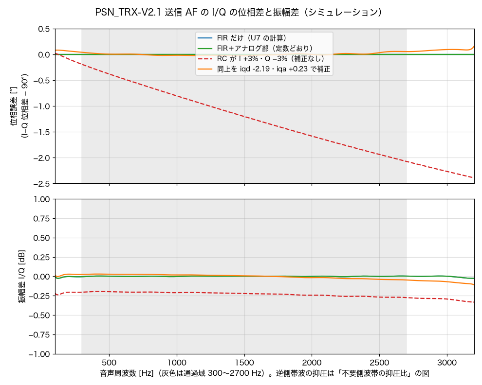
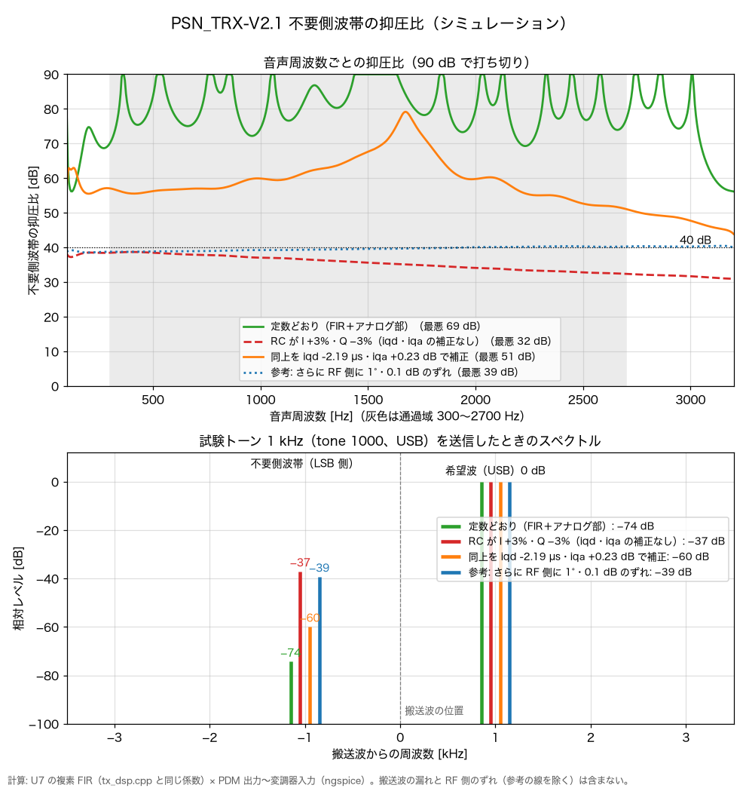
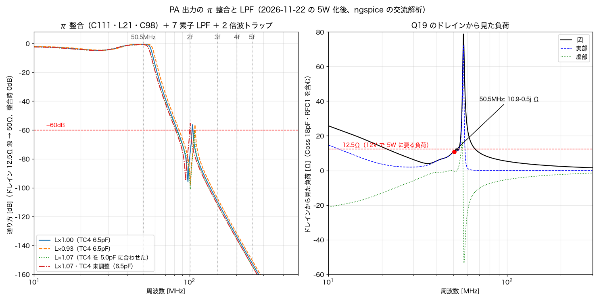
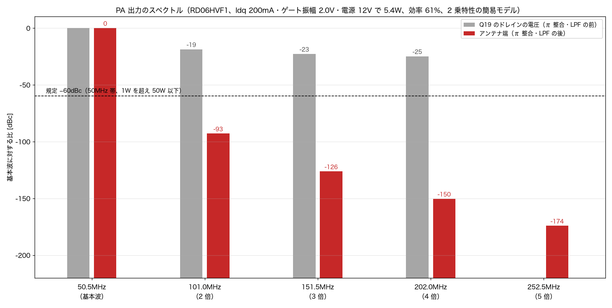

# PSN_TRX-V2.1 アナログ部シミュレーション結果

- 実行日：2026-11-22（送信 5W 化の回路で計算し直して置き換え）
- 対象：PSN_TRX-V2.1 基板 Ver 2.1.0（50MHz SSB トランシーバ、受信 12MHz シングルスーパー）（回路図 `kicad/PSN_TRX.kicad_sch`）。11-11 の V2 Ver 1.4 から回路で変わったのは、L15 270nH → 330nH と、**2026-11-22 の送信 5W 化**（Q18 2SC1815 → **KSP10**、Q19 のドレインに **π 整合** C111 330p・L21 62nH・C98 39p → 270p、C94 0.001u → 0.01u）。U1・U2 の SIP 化基板、TO-92 の足の間隔、コンデンサの部品形の変更は回路のつながり・定数を変えないので結果に影響しない
- シミュレータ：ngspice-45.2（KiCad 10.0.6 同梱の libngspice を Python から呼ぶ）
- 使用データ：回路図から `kicad-cli` で書き出したネットリスト（`kicad/sim/net.json`）と、`kicad/sim/` の解析モデル
- 実施内容：直流動作点、送信／受信 AF の AC 解析、送信 I/Q スキャン、PA 出力の π 整合と LPF、PA 入力、RFC1、DC-DC 入力フィルタ、AGC、過渡解析、受信部（前段・ラダーフィルタ・利得・レベル配分）、回路全体（受信・送信、送信は高調波と 2 トーンの相互変調まで）、ブロックごとの確認
- 再計算の方法：`kicad/sim` で `./run.sh`（結果は `results.txt`）。I/Q のグラフ・PA の図は numpy・matplotlib の入った Python で `iq_scan.py`・`sideband.py`・`pa_plots.py`

## 総合結果

全解析が正常に収束しました。直流動作点の異常や、設定した部品ばらつき範囲での PA 出力 LPF の大きな劣化は見られませんでした。

**送信 5W 化（2026-11-22）**：12V の電源で 5W を出すには、Q19 のドレインから見た負荷を約 12Ω にする必要があります（50Ω のままでは約 2W で頭打ち）。そこで、ドレインに C111 330p・直列に L21 62nH・その先に C94（直流カット）と C98 270p を置く **π 整合**を入れ、ドレインに **約 11Ω** を見せるようにしました（4 章）。あわせて、50MHz で利得の足りなかった励振の Q18（2SC1815、fT 80MHz）を **KSP10**（fT 650MHz）に替えました。計算では、電源 12V で変調器の音声 200〜300mV のとき **4.5〜5.7W**、電源電流 0.7〜0.8A、効率約 60％、ドレインの最大 約 24V（RD06HVF1 の VDSS 50V）です（6 章・7 章）。

**スプリアス**：アンテナ端の 2〜5 倍波は **最大 −91dBc**（電源 12／13.8V、出力 0.05〜9W の全条件）で、50MHz 帯 1W を超え 50W 以下の規定（搬送波より 60dB 低い値）に対して約 30dB の余裕があります（8 章）。π 整合が低域フィルタとしても働くので、LPF だけのときより 2 倍波が約 20dB 減りました。ただし、基板上の結合・寄生発振は計算に入っていないので、実機のスペクトラムアナライザでの確認が必要です。

PA の入力は L 型で 50Ω に整合しています（C92 150pF・C93 33pF・L15 **330nH**）。50Ω 源に対する不整合損失は **0.1〜1.5dB**（励振が弱いとき 0.1〜0.4dB、強いとき 1.4〜1.5dB）です（5 章）。受信部・AF・AGC・DC-DC の結果は 11-11 と同じです。

一方、次の項目は実機の調整・確認で特に重視してください。

- **2 倍波トラップ（TC4）の調整**：合わせないと 2 倍波の減衰が約 −30dB まで戻る条件がある
- **送信の RF 側の I/Q（VR3・VR4）とキャリアの漏れ（VR5・VR6）**：中点のままでは RF 側だけで逆側帯波の抑圧が 31dB、キャリアの漏れが +10dBm（励振の利得が上がった分、漏れも大きい。VR5・VR6 を合わせて −13dBm、5W に対して −50dBc）
- **送信の出力レベル**：`out` を上げきると 12V で約 7W、13.8V で約 9W まで出てしまう（RD06HVF1 の定格を超え、IM3 も −12dB まで悪くなる）。電力計を見ながら **尖頭 5W** で `out` を止める（ファームウェアの初期値は 5％）
- **L21（π 整合の空芯コイル）**：巻き線の間隔で出力最大に合わせる。配線の長さの分のインダクタンスも足されるので、実機の最適は計算の 62nH より小さめになることがある
- **2SK192A の個体差と AGC の効き方**：ドレイン電流が 4.7〜10.5mA、AGC の効き始めがトランジスタの hFE で大きく変わる

## 1. 直流動作点

電源 11／12／13.8V、トランジスタ hFE の下限・上限の全 6 条件で計算しました。

| 項目 | 結果 | 評価 |
|---|---:|---|
| Q2・Q3（RF 増幅）、Q6・Q7（IF 増幅）2SK192A-BL カスコード | 各 約 7.4mA | 全電源条件で収束 |
| Q13（2SC2120）／Q12（2SA950）AF 出力段 | アイドル 36.6〜68.3mA、各 最大 237.1mW | 今回のモデル範囲で最大 |
| Q18（KSP10、送信の 50MHz 増幅） | 8.5〜12.0mA、最大 150.4mW | KSP10 の許容 350mW に対し約 43%。実機では温度を確認 |
| R41（AF 出力段のエミッタ側、100Ω 1W） | 最大 0.470W | 1W 品に対し約 47% |
| Q4・Q17（2SK439、局発バッファ・送信増幅） | 各 約 6.7mA、最大 90.6mW | 全条件で一定 |
| U5A（マイクアンプ）出力の直流 | 2.500V | 全条件で一定 |
| マイクのバイアス（+5V から給電） | 2.15V | 電源電圧によらず一定 |
| AGC_PWM＝0V のときの Q21 の電流 | 0mA | AGC オフ（Q2_G2 は 3.7〜4.6V） |
| 送信検出 Q22 | 0.33mA、コレクタ 0.02V（TX_SENSE 0.02V） | 全条件で一定 |

2SK192A-BL の個体差（VGS(off) −1.2〜−3V・IDSS 12〜24mA）では、ソース抵抗 R3・R18（100Ω、回路図どおり）でドレイン電流が 4.7〜10.5mA まで変わります。動作点は得られていますが、受信感度・歪み・消費電流への影響は実機で確認し、必要なら R3・R18 で 5〜8mA に合わせてください（47Ω で 6.8〜14.8mA、150Ω で 3.7〜8.4mA）。

## 2. 送信・受信 AF

### マイク入力から AF_ADC（U7 の A2）

- 300〜2700Hz の相対レベル：+0.1〜−0.5dB（1kHz 基準）
- 1kHz・1Pa 入力時の AF_ADC：225〜234mVrms
- 同条件の U5A 出力：324〜337mVrms
- 範囲は L7 の直流抵抗 30〜90Ω の差

音声帯域内はほぼ平坦です。U5A は 3Pa（103.5dB SPL）付近から頭打ちになります（6 章）。ADC の実際の入力範囲に対する余裕は、マイク感度、最大音圧、ファームウェア側の利得（`mic`）設定を含めて確認してください。

### PDM 出力から変調器入力

- 定数どおりでは、アナログ部の I/Q の位相差・振幅差は 0
- 300〜2700Hz の相対レベル：0〜−0.4dB
- 負荷 200Ω：78kHz の減衰 −30.0dB、156kHz の減衰 −56.7dB
- 負荷 1000Ω：78kHz の減衰 −36.8dB、156kHz の減衰 −55.3dB

### 受信 AF（積検波 U2 の出力 → Q9 → スピーカー 8Ω）

| 音量位置 | 1kHz 利得 | 300Hz（1kHz 基準） | 2700Hz（1kHz 基準） |
|---|---:|---:|---:|
| 0.2 | 29.8dB | +0.6dB | −2.0dB |
| 0.5 | 33.3dB | +0.7dB | −2.0dB |
| 0.9 | 41.9dB | +0.3dB | −2.0dB |

## 3. 送信 I/Q と逆側帯波の抑圧

U7 の複素 FIR（ファームウェアと同じ係数・同じ int16 量子化）とアナログ部（ngspice）を組み合わせた 100〜3200Hz スキャンの、通過域 300〜2700Hz における最悪値です。

| 条件 | 位相誤差 | 振幅差 | 逆側帯波の抑圧 |
|---|---:|---:|---:|
| 定数どおり | 0.000° | 0.006dB | 69.3dB |
| RC が I +3％・Q −3％、補正なし | 2.074° | 0.275dB | 32.4dB |
| 同上、`iqd -2.19`（µs）・`iqa +0.23`（dB）で補正 | 0.056° | 0.048dB | 51.1dB |

1kHz の試験トーン（`tone 1000`、USB）での値は、定数どおり 74.3dB、補正なし 37.0dB、補正後 59.9dB です。参考として RF 側（Si5351 の 2 出力・変調器）に 1°・0.1dB のずれを足すと 38.7dB（1kHz で 39.2dB）になり、実機の抑圧はほぼ RF 側で決まります（7 章の送信の全体も参照）。

部品のばらつきがある場合は `iqd`・`iqa` の補正が有効です。ただし、補正値は実際の基板・部品に合わせて調整し直してください。

上の図は I と Q の位相差の 90° からのずれと振幅差、下の図はそこから決まる逆側帯波の抑圧比（上の段）と、1kHz の試験トーンを送信したときのスペクトル（下の段）です。

## 4. PA 出力の π 整合と LPF

回路は、Q19 ドレイン →［C111 330p］→ L21 62nH → C94 0.01µ（直流カット）→［C98 270p］→ L16 →［C99＋TC3］→ L17 →［C101、トラップ L18＋(C100∥TC4)］→ L19 →［C102］→ 50Ω です。C111・L21・C98 が π 整合で、C98 は LPF の入力側シャントも兼ねます。

ドレインから見た負荷（L×1.00・Coss 18p・TC3 11p）：

| 周波数 | ドレインから見た負荷 |
|---|---:|
| 50.0MHz | 10.6−j0.3Ω |
| 50.5MHz | 10.9−j0.5Ω |
| 51.0MHz | 11.0−j0.6Ω |
| 2 倍波 101MHz | 5.2Ω |
| 3 倍波 151.5MHz | 3.2Ω |

高調波ではドレインから見たインピーダンスが低いので、ドレインの電圧の山が抑えられます（6 章の大信号でドレイン最大 約 24V。整合なしのときは 29.6V）。

L19／L16／L17 を ±7％、Q19 の出力容量 Coss を 18／25pF、トラップの L18 を ±7％変え、各条件で TC4 を 2 倍波最小、TC3 を反射減衰量最大に合わせました（ドレイン側 12.5Ω 源・50Ω 負荷。反射減衰量は 12.5Ω に対して）。

| 指標 | 全条件の範囲 | （参考）π 整合なし・50Ω 源 |
|---|---:|---:|
| 50.5MHz 挿入損失 | 0.53〜0.64dB | 0.41〜0.53dB |
| 反射減衰量 | 20.7〜36.9dB | 21.7〜42.4dB |
| 2 倍波の減衰 | 93.6〜98.3dB | 70.5〜76.1dB |
| 3 倍波の減衰 | 106.7〜110.5dB | 75.3〜79.8dB |
| 4 倍波の減衰 | 131.1〜134.7dB | 94.3〜98.7dB |
| 最適 TC3 | 5〜10pF | 8〜16pF |
| 最適 TC4 | 5.0〜6.5pF | 5.0〜6.5pF |

最適な TC3 は 5〜10pF で、L が +7％側では TMCV01（5〜30pF）の下限の 5pF になります。TC3 が下限で合わないときは、L21 の巻き線の間隔（4 章の π 整合）で合わせます。L18 が +7％側の条件では、TC4 を 6.5pF のままにすると 2 倍波の減衰が約 53〜55dB まで下がりました（π 整合なしでは約 30dB）。**TC4 による 2 倍波トラップの調整は必須**です（`manual/調整手順.md`）。高調波の値は理想化した 50Ω 源・負荷と簡易な損失モデルによるもので、実機のスプリアス規定への適合を直接保証するものではありません。

## 5. PA 入力・RFC1

整合回路は、L14 のリンク → C92 150pF（直流カット）→ C93 33pF（GND へ）→ L15 330nH → Q19 のゲート の L 型です。C93（並列 C）と L15（直列 L）で、ゲートの低いインピーダンス（ゲート容量・ミラー容量・バイアス抵抗）を 50Ω に変換します。

| 条件（gm・VR7 の位置） | 入力インピーダンス | 不整合損失 |
|---|---:|---:|
| 0.3S・0.3 | 58.3−j8.5Ω | 0.1dB |
| 0.3S・0.7 | 89.6−j12.8Ω | 0.4dB |
| 1.0S・0.3 | 81.8+j74.6Ω | 1.5dB |
| 1.0S・0.7 | 117.8+j68.4Ω | 1.4dB |

- ゲート電圧の上限（VR7 最大）：11V で 6.63V、12V で 7.23V、13.8V で 8.31V
- RFC1（10µH、自己共振 29MHz、分布容量 3pF）の 51MHz のインピーダンス：約 −j1531Ω（容量性）。5W 送信でドレインの直流 約 0.7〜0.8A が流れる（AL0510-100K の定格電流 2.5A）。ドレインの約 11Ω に対して十分大きい

L15 を 330nH にしたので、270nH のとき（0.2〜0.4dB）より誘導性に寄り、励振が強いときの損失が増えています。残る幅は、Q19 の個体と励振の強さ（gm）、VR7 の位置でゲートのインピーダンスが変わるためです。信号源（L14 のリンク）を 50Ω と仮定しているので、実際のリンクのインピーダンスによって最適値は少し変わります。RFC1 は 51MHz で自己共振より上にあり容量性です。実部品の自己共振のばらつきも考えてください。

## 6. DC-DC 入力フィルタ・AGC・過渡解析

### DC-DC 入力フィルタ（L20・C106）

R-78E の入力側から見たインピーダンスは、設定した 3 条件で 15.8〜16.2kHz にピークを持ち、最大 4.06Ω でした。R-78E の簡易な負性入力抵抗は、入力電力 1.5／2.5W のときそれぞれ −96／−58Ω です。

この単純な比較では大きな相互作用は見られませんが、DC-DC の周波数による入力インピーダンスを含めた解析ではないので、起動・負荷の急変・入力電圧の変動は実機で確認してください。

### AGC（Q21 → Q2_G2）

Q2_G2 は AGC_PWM の平均電圧が上がると下がります。hFE による制御特性の差が大きく、たとえば PWM 平均 0.70V では hFE 200 で 1.82V、hFE 400 で 0.35V です。効く量は RF 増幅（Q3 のゲート 0V で −15.7dB）と IF 増幅（Q7 のゲート 0V で −15.5dB）の合計で約 −31dB です。AGC のしきい値・ループ利得は個体差を含めて調整してください。

### 過渡解析

- 受信 AF の最大出力（1kHz、音量 0.9、12V）：歪み率 1％以下で 3.8mW、3％以下で 23.2mW、10％以下で 75.8mW、最大 約 113mW
- マイク入力の飽和：2Pa（100dB SPL）まで歪み 0％、3Pa で 15.8％、5Pa で 49.4％。10Pa では AF_ADC が −0.06V まで下がる瞬間がある（ADC の入力範囲をわずかに下回る）
- 変調器入力の歪み（I 側、PDM 出力レベル 10％）：ALC の効き始め −20dBFS で 1.2〜1.4％、−12dBFS で 3.1〜3.6％
- PA 大信号（RD06HVF1 を 2 乗特性の簡易モデルで近似、ゲート直接駆動、π 整合＋LPF、電源 12V）：

| Idq | ゲート振幅 | 出力 | 効率 | 電源電流 | ドレイン最大 | 出力の 2 / 3 倍波 |
|---:|---:|---:|---:|---:|---:|---:|
| 200mA | 1.0V | 2.33W | 41％ | 0.47A | 19.8V | −90 / −155dBc |
| 200mA | 1.5V | 4.45W | 57％ | 0.65A | 22.8V | −90 / −134dBc |
| 200mA | 2.0V | 5.40W | 61％ | 0.74A | 23.8V | −93 / −126dBc |
| 200mA | 2.5V | 5.98W | 62％ | 0.80A | 24.5V | −95 / −124dBc |
| 50mA | 2.0V | 4.57W | 60％ | 0.64A | 23.1V | −89 / −134dBc |

  ゲートを約 2V 振ると 5W 出ます。5W のときの Q19 の損失は約 3.5W で、放熱器 HS1（11.9℃/W）の温度上昇は約 +40℃ です。整合なし（11-11）は同じ駆動で 2.2〜2.5W が上限でした。
- 電源投入（RX12V が 1ms で 0→12V）時のスピーカーのポップ音：最大 +0.33V（瞬間 14mW）、19ms で 0.1V 以下に戻る
- 送信開始（TX12V が 10µs で 0→12V）：変調器入力が 95〜115ms で ±10mV 以内に落ち着く。AF_ADC は 295ms で落ち着く（ファームウェアは送信開始から 0.45 秒無音）

## 7. 受信部と回路全体

### 受信の前段（入力同調 → Q2・Q3 → 出力同調）

L2 のタップ 3 回目（回路図どおり）で、TC1 11.0pF・TC2 18.5pF（トリマの範囲内）。

| 項目 | 結果 |
|---|---:|
| 電力利得 | +22.6dB |
| 雑音指数 | 0.88dB |
| −3dB 帯域 | 49.18〜51.88MHz |
| イメージ 26.5MHz | −48.3dB |
| 27MHz 帯 | −47.6dB |
| 半 IF 44.5MHz | −19.8dB |
| 局発 38.5MHz の漏れ | −32.5dB |
| 12MHz の素通り | −66.4dB |
| FM 放送 76／90MHz | −39.7／−46.2dB |

### 12MHz ラダーフィルタ（水晶の運動定数は仮定：Cm 15fF、Rs 25Ω、C0 4pF）

今の定数（82p／100p／120p／100p／82p、終端 330Ω）で、損失 6.1dB、−6dB 幅 2560Hz、−60dB 幅 7710Hz、通過域のリップル 3.0dB、中心は 12MHz から +1530Hz です。水晶の Cm が 10〜20fF だと −6dB 幅が 1700〜3410Hz まで変わるので、実際の水晶で測って BFO の位置を合わせてください。

### レベル配分（AGC なし、NJM2594 の変換利得 0dB と仮定、S9 ＝ −73dBm）

- アンテナ端 → 積検波の入力：+60.1dB（BPF +20.3、RF +13.1、混合後 +18.7、水晶 −6.1、IF +14.0）
- S9 で積検波の出力 約 50mVrms、スピーカーは出力段の最大（約 113mW）で頭打ち
- AD8307（S メーター）の入力：S1 で −51.9dBm、S9 で −4.0dBm（範囲 −75〜+17dBm）

### 受信の全体（アンテナ → スピーカー、USB、音量 0.9）

- 音声の −6dB 帯域：300〜2830Hz
- 逆側帯波：−33.1dB（1kHz）、−48.9dB（2kHz）
- 隣接：+3.5kHz −30.6dB、+5kHz −68.9dB、−3kHz −60.6dB、−5kHz −77.8dB
- イメージ −48.3dB、12MHz の素通り 約 −96dB（混合器の漏れ −30dB と仮定）
- 感度：前段の雑音指数 0.9dB、混合器の雑音指数を 10〜15dB として全体 1.0〜1.4dB、最小検出信号 約 −139dBm（帯域 2.4kHz）

### 送信の全体（局発・変調器 → Q17 → Q18 KSP10 → PA → π 整合・LPF → 50Ω、7T50 の値は仮定、Idq 200mA）

| 電源 | 変調器の音声入力 | 出力（50Ω） | 電源電流（TX12V） | 2 倍波 |
|---:|---:|---:|---:|---:|
| 12V | 20mV | 47mW（16.8dBm） | 0.25A | −107dBc |
| 12V | 50mV | 0.35W（25.4dBm） | 0.29A | −98dBc |
| 12V | 100mV | 1.38W（31.4dBm） | 0.42A | −92dBc |
| 12V | 200mV | **4.50W**（36.5dBm） | 0.69A | −91dBc |
| 12V | 300mV | **5.70W**（37.6dBm） | 0.80A | −94dBc |
| 12V | 400mV | 6.36W（38.0dBm） | 0.86A | −96dBc |
| 12V | 800mV | 6.95W（38.4dBm） | 0.92A | −96dBc |
| 13.8V | 300mV | 6.76W（38.3dBm） | 0.85A | −92dBc |
| 13.8V | 800mV | 9.14W（39.6dBm） | 1.05A | −96dBc |

- Q18 を KSP10 にしたので、同じ変調器入力で出力は 11-11（2SC1815、1W 版）より約 13dB 大きくなります。音声 200〜300mV で 5W に達し、それより上は飽和に近づきます。**`out` は尖頭 5W で止めます**（13.8V で上げきると 9W を超え、RD06HVF1 の定格 6W を超える）
- 2SC1815 のままでは、Q19 のゲートを約 1V までしか振れず、π 整合を入れても約 2W で頭打ちでした（Q18 の fT 80MHz で 50MHz の利得が足りない）
- キャリアの漏れ：VR5・VR6 の中点で +10dBm、VR5 0.50・VR6 0.53 に合わせて −13dBm（5W に対して −50dBc。計算は VR を 0.01 刻みで探した値で、実機ではさらに細かく合わせる）。D4 の IS が 30％大きいと +13dBm（VR5 で打ち消す）
- I と Q の RF 側の位相差：中点で −93.3°（RF 側だけで抑圧 31dB）→ VR3 0.9・VR4 0.60 に合わせ、振幅を `iqa` で補正すると 57dB（位相差 −89.8°。VR4 を 0.05 刻みで探した値なので、実機で細かく合わせればさらに上がる）

## 8. 送信のスプリアスと相互変調（5W 化の確認）

### 高調波（アンテナ端）

高調波は、過渡解析で求めた C98 の点（π 整合の 50Ω 側）の電圧の各倍波に、そこからアンテナ端までの LPF の通り方（交流解析）を掛けて出しました。アンテナ端の小さな値を過渡解析で直接読むと、計算の誤差（3 倍波で −45dBc 程度に見える）が出るためです。

| 電源 | 出力 | 2 倍波 | 3 倍波 | 4 倍波 | 5 倍波 |
|---:|---:|---:|---:|---:|---:|
| 12V | 1.38W | −92dBc | −117dBc | −166dBc | −175dBc |
| 12V | 4.50W | −91dBc | −116dBc | −154dBc | −177dBc |
| 12V | 5.70W | −94dBc | −115dBc | −150dBc | −181dBc |
| 12V | 6.95W | −96dBc | −125dBc | −150dBc | −169dBc |
| 13.8V | 6.76W | −92dBc | −115dBc | −151dBc | −178dBc |
| 13.8V | 9.14W | −96dBc | −119dBc | −150dBc | −171dBc |

- 全条件での最大は **−91dBc**（2 倍波）。50MHz 帯のアマチュア局で空中線電力が 1W を超え 50W 以下の場合のスプリアス領域の規定（搬送波電力より 60dB 低い値）に対して、**約 30dB の余裕**があります
- 帯域外領域の規定（1mW 以下、かつ平均電力より 60dB 低い値）は無変調で測ります。無変調では、送信帯域の中に出るキャリアの漏れ以外はほとんど出ません
- 計算に入っていないもの：基板の上の結合（LPF の入口と出口、コイル同士）、アースの共通インピーダンス、電源線からのもれ、寄生発振。実機の高調波は −60〜−70dBc 程度に落ち着くことも多いので、**スペクトラムアナライザでの実測が必要**です。Q18 を KSP10 にして利得が上がったので、高調波でない周波数に発振が出ていないことも確かめてください

上の図は PA を直接駆動した計算（Idq 200mA・ゲート振幅 2.0V、5.4W）での、ドレインの電圧とアンテナ端の高調波です。

### 2 トーンの相互変調

I 側に同じ大きさの 2 つの音声を入れたときの出力を、音声の大きさごとの出力の振幅・位相の表から準静的に計算しました（各トーン比）。

| 尖頭の音声 | 尖頭電力（PEP） | IM3 | IM5 |
|---:|---:|---:|---:|
| 100mV | 1.38W | −31dB | −33dB |
| 200mV | 4.50W | −37dB | −35dB |
| 300mV | 5.70W | −21dB | −43dB |
| 400mV | 6.36W | −16dB | −34dB |
| 600mV | 6.85W | −12dB | −24dB |

- 尖頭 4.5W までは IM3 −30dB 以下ですが、5.7W を超えると飽和で急に悪くなります。**尖頭 5W 前後で使う**ことを勧めます
- 出力の位相の変化（AM-PM）は、小信号から音声 600mV までで +6.8° です
- 相互変調は帯域外領域に出ますが、帯域外領域の規定は無変調で測るので、規定の数値には入りません。隣の周波数を乱さないよう、ALC と `out` で抑えて使います
- 表の値は 12.5mV 刻みの表を直線でつないだ計算なので、小さい出力の IM の値は目安です

### ブロックごとの確認

- 7T50（FCZ 07S50）：L3（38.5MHz）、L12〜L14（50.5MHz）とも、コアで合わせられる範囲内（コアの端まで +6〜+9％）
- U1 のキャリア入力 約 354mVrms、U2（BFO）約 102mVrms
- 送信表示の LED は出力 約 10mW 以上で点灯（約 10mA）
- 送受切替：Q1（2SA1015）に必要な hFE 18 に対し、ベース電流 2.32mA で十分に飽和

## 解析の適用範囲

- 本結果は、`kicad/sim/` の等価回路・簡易デバイスモデルによるシミュレーションです。トランジスタはデータシートの代表値から作った簡易モデルです。
- 基板の配線の寄生成分、コイルの実測 Q、コア損失、温度、実部品の完全な SPICE モデルは含みません。水晶・7T50・混合器（NJM2594）の値は仮定です。
- PA の大信号解析は 2 乗特性の簡易モデルによるもので、送信の出力・相互変調の値も目安です。最大出力・効率・歪み・発熱・発振の余裕を直接評価するものではありません。KSP10 のモデル（fT 650MHz、hFE 60）も代表値から作った簡易なものです。
- 高調波は C98 の点の電圧に LPF の通り方（交流解析）を掛けて出しています。基板上の結合・発振を含まないので、スプリアスの規定への適合は実測で確かめてください。
- ESP32（XIAO）のファームウェアの実行そのものは計算していません。I/Q の解析では、`iq_scan.py` に実装した FIR・補正のモデルを使っています。
- 実機では、直流電圧・電流、AF 応答、受信感度・選択度、PA 出力の波形・スペクトル、高調波、AGC の動作、温度を確認してください。
